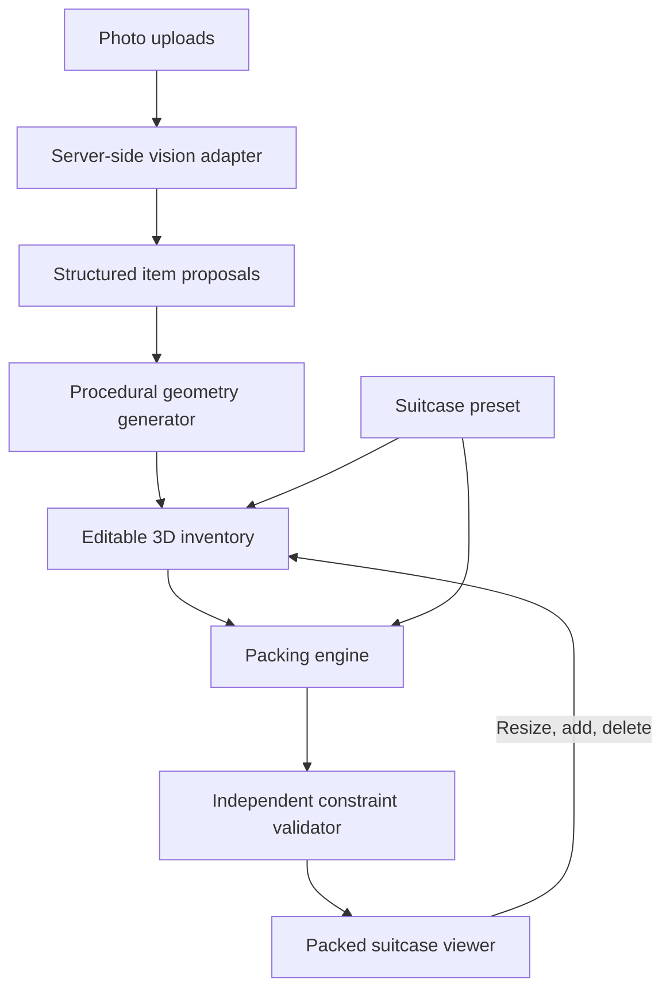

# Knapsack design

Status: local prototype implemented; validation in progress. Current commands/results and remaining work are in `PROGRESS.md`. Browser tests and approval checkpoints are in progress; implementation is not yet declared fully verified.

## Implemented decisions (2026-10-24)

- One Next.js 16 App Router application: landing at `/`, interactive planner at `/pack`, server vision endpoint at `/api/analyze`. Concurrent landing-page work has been preserved.
- React Three Fiber / Drei category geometry stays inside conservative rectangular item envelopes. Solver axes are millimeter X=width, Y=length, Z=up; renderer axes swap length/up with 100 mm per world unit and signed proper rotations.
- Four bounded deterministic candidate orders prefer supported lower placements, 3 mm margins, and 65% footprint support. Worker calculations debounce 180 ms. A separately implemented validator checks all accepted plans, and full geometry/suitcase revisions reject stale results.
- The server uses OpenAI Responses image input and strict Structured Outputs, configurable `OPENAI_VISION_MODEL` (default `gpt-4.1-mini`). The wire schema uses named width/length/height to avoid tuple prefixItems; application boundaries normalize to a validated tuple. Credentials stay server-side. App server photo retention is zero; provider retention follows the account's policy, with `store:false` for Responses.
- Per-photo requests support multiple uploads with two concurrent analyses, max 6 MB JPEG/PNG/WebP each, 12 retained photos and 80 total items including manual additions and duplicates. Overflow preserves existing data and reports omitted proposals. Successful analysis records are immutable; retries cannot replace edits or revive deletions.
- IndexedDB stores photos separately from frequently saved inventory metadata. Reload marks interrupted analyses retryable. Manual additions, corrections, explicit source-preserving merges, layer inspection, exploded views, playback, and empty/partial/error states are implemented.
- Demo inventory is a fixed nine-item fixture, explicitly labeled and independent of the live adapter. Photo fixtures and recognition expectations live in `public/fixtures/README.md`; live API and browser evidence are recorded separately.

This document records the product decisions made after the initial README. Where they differ, this design takes precedence: the first release centers on uploaded photos, editable 3D items, and a fully packed 3D suitcase. Entering or confirming numerical measurements is not a required step.

## Product goal

Turn photos of a traveler's belongings into an interactive simulation of their fully packed suitcase. The traveler can inspect the arrangement, correct the generated items visually, and understand how to pack them.

The primary deliverable is the complete 3D suitcase containing the included items. Photo recognition, inventory management, and the basic web interface support that result.

The simulation is a packing layout based on approximate geometry. The prototype does not require a physics engine or photo-faithful reconstruction.

## Intended experience

1. **Choose a suitcase.** Start with a visual size preset. Support brand/model selection when reliable interior dimensions are available. Numerical customization can remain optional.
2. **Upload item photos.** Accept multiple photos and show processing progress. Users can add more photos later.
3. **Review generated items.** Display recognizable 3D approximations beside the source photos, with the suitcase visible as a size reference.
4. **Edit visually.** Select an item and make it bigger or smaller with a slider or drag handles. Offer width, height, and depth adjustments when uniform scaling is insufficient.
5. **Correct the inventory.** Add missing items, delete incorrect detections, duplicate an item, or merge detections that represent the same physical belonging.
6. **Pack.** Compute an arrangement and show the fully packed suitcase. Explain any items that could not be placed.
7. **Inspect and revise.** Orbit, zoom, select items, hide upper layers, and step through packing order. Resizing, adding, or deleting an item updates the inventory and triggers a new packing calculation.

Keep numerical dimensions out of the default interaction. They can be available in advanced controls without becoming a prerequisite.

## Architecture

Start with one web application and clear internal modules. Separate services, accounts, and a database are unnecessary for the first demonstration.

| Component | Responsibility |
| --- | --- |
| Upload interface | Accept photos, show progress, and support retries. |
| Vision adapter | Send images to a vision-capable model and normalize the returned proposals. |
| Inventory store | Maintain item identities, source-photo associations, user edits, and revisions. |
| Geometry generator | Build editable meshes and matching packing envelopes. |
| Packing engine | Compute positions, orientations, and a proposed packing sequence. |
| Constraint validator | Check the proposed arrangement independently of rendering. |
| Suitcase viewer | Render the arrangement and support inspection and visual editing. |
| Session persistence | Restore the current suitcase, inventory, edits, and plan. |

## Vision and photo processing

A vision-capable LLM can accept multiple photos and propose item labels, categories, colors, shape parameters, and initial dimensions. These are estimates to review visually, not measured geometry.

Process photos incrementally in bounded batches so the interface can display results without waiting for the entire collection. Preserve upload IDs and associate every proposal with its source photos. A retry must not silently add the same proposals again.

Multiple photos can show one item, and one photo can show several items. Suggest duplicate matches for review rather than silently merging similar belongings. Two identical shirts may be two physical items.

Validate model output against an application schema before creating geometry. Missing or invalid fields should produce an editable fallback item or a retry option. A failed analysis must not prevent manual additions or packing the existing inventory.

Keep provider-specific requests behind the vision adapter. Astra is the originally proposed vision component; the exact supported model and API integration remain an implementation decision. Codex supports development.

Send credentials only from the server. Photo processing is the expensive remote operation; ordinary editing and packing should not require another model call.

## Generated 3D items

Use procedural category-based models for the prototype:

- Folded clothing: rounded rectangular bundles.
- Shoes: simplified shoe-shaped geometry within a conservative envelope.
- Bottles: cylinders or capped bottle shapes.
- Toiletry pouches: rounded boxes.
- Unknown objects: editable boxes with a source-photo thumbnail.

The vision model supplies a description and parameters; application code constructs the mesh. A separate image-to-3D reconstruction system would be needed for photo-faithful meshes and is deferred.

Each item has two related representations:

- **Display geometry:** the recognizable object shown in the scene.
- **Packing envelope:** a conservative shape used for fit and collision calculations.

Keep display geometry inside its packing envelope. Resizing updates both representations together. For the first engine, use rectangular envelopes even when the displayed object is rounded or cylindrical.

Use stable item IDs for selection and edits. Give duplicated items new IDs. Keep user overrides separate from model estimates so retries cannot overwrite a resized or renamed item.

## Scale and uncertainty

Initialize item dimensions from category defaults and model estimates, then let users adjust their size beside the suitcase. The suitcase preset provides a consistent scene reference.

Absolute physical scale cannot be recovered reliably from arbitrary photos alone. The interface should describe the result as an estimated fit and allow easy correction. A known-size reference object, bag model lookup, or optional dimensions can improve scale later without requiring measurement entry from every user.

Use one internal unit system, such as integer millimeters, with a documented coordinate convention. Convert to rendering units at the scene boundary. Store the size source and user scale overrides internally.

Weight is secondary to the spatial simulation. It must not block the core journey. If added, distinguish estimated from measured weight, include empty suitcase weight, and show unknown values explicitly. Do not present estimated weight as a verified baggage allowance check.

## Packing engine

The initial mode tries to place every included item in one suitcase. It must never silently remove an item to produce a successful result. Priority-based selection of what to leave behind is a later mode.

Model the suitcase as a rectangular usable interior. Add a conservative clearance margin. More detailed compartments, wheels, curved walls, and an opening path can follow once the core layout works.

Start with a deterministic heuristic:

1. Sort larger or more constrained items first.
2. Try permitted orientations at candidate free-space positions.
3. Reject placements outside the usable interior or overlapping existing envelopes.
4. Prefer supported placements near the bottom and compact arrangements.
5. Try a bounded set of alternate item orders if the first arrangement leaves items unplaced.

For rectangular envelopes, rotations are axis-aligned dimension permutations. Apply the chosen orientation consistently to the display mesh and envelope.

Return each item's position, orientation, occupied dimensions, and proposed packing order. Report unplaced item IDs and useful reasons separately.

Distinguish these outcomes:

| Outcome | Meaning |
| --- | --- |
| Complete arrangement | Every included item has a placement that passes validation. |
| Partial arrangement | Some items have valid placements; the remaining items are shown outside the suitcase. |
| Search limit reached | The bounded search did not find a complete arrangement. |
| Proven constraint conflict | A direct check establishes a conflict, such as an item exceeding the bag in every allowed orientation. |

A heuristic failing to find a layout does not prove that no layout exists. Use wording that preserves this distinction.

Validate bounds, overlap, item completeness, and permitted orientations in a separate module. Surface support and packing-order limitations where the prototype cannot establish practical packability. A static collision-free arrangement alone does not prove that a traveler can insert every item in that order.

## Packed suitcase viewer

Use Three.js as the proposed rendering foundation. Keep layout calculations outside the scene graph so geometry can be validated without a browser renderer.

The main view should show an open suitcase with all successfully placed items. Provide:

- Orbit and zoom, with a reset-view control.
- Selection that links the 3D item to its photo and inventory entry.
- Layer hiding or an exploded view to reveal covered items.
- Step-by-step placement playback.
- A visible area for unplaced items.
- Bigger/smaller controls, optional axis handles, duplicate, and delete.
- An add-item action using another photo or a category template.

Show a resized mesh immediately. Debounce packing recalculations while the user drags, then validate the final arrangement after release. Move packing work into a browser worker if it blocks interaction. Repacking should not trigger vision analysis again.

Keep item colors and identities stable across repacks. Prefer retaining existing placements where feasible so small edits do not unnecessarily scramble the whole scene.

## State and data contracts

| Entity | Essential fields |
| --- | --- |
| Photo | ID, local/server reference, processing status, analysis request ID. |
| Item | ID, source photo IDs, label, category, geometry parameters, estimated dimensions, user overrides, allowed orientations, inclusion state. |
| Suitcase | ID, preset/model, usable interior dimensions, clearance margin, optional weight metadata. |
| Inventory revision | Revision ID covering all solver inputs: items, dimensions, orientations, inclusion, and suitcase settings. |
| Packing plan | Input revision, algorithm version/seed, placements, unplaced IDs, validation results, and search outcome. |

A plan belongs to a specific input revision. Editing an item or changing the suitcase marks the previous plan stale. Discard late packing results for older revisions.

Accept late vision proposals without overwriting user edits. Deleting an item must not allow an old analysis response to recreate it silently. Track dismissed proposals or their source associations.

Persist session metadata locally for the prototype. Use browser blob storage for retained photos where practical. Add server persistence when saved trips, accounts, or sharing become necessary.

## Failure handling and privacy

Preserve the editable inventory when a photo fails, an API request times out, or a packing search reaches its limit. Provide retry and manual-add paths.

Show progress per photo and for packing. Cancel obsolete calculations or ignore their results using revision checks. Apply upload limits and bounded processing concurrency.

Explain when photos are sent for analysis. Avoid retaining raw photos on the application server by default; define retention explicitly if storage is introduced. Keep credentials and raw photo content out of application logs.

Photo upload is the first input method. Live camera capture can be added later with permission handling, HTTPS, and upload fallback.

## Implementation milestones

1. **Prove the packed scene.** Use a fixed item inventory and suitcase to build the complete 3D arrangement, independent validation, selection, and layer inspection.
2. **Make the scene editable.** Add visual resizing, add/delete/duplicate actions, revisions, and repacking. Keep numerical entry optional.
3. **Connect photos.** Add server-side analysis, category-based model generation, source-photo previews, and duplicate review.
4. **Complete the demo.** Add progress and recovery states, local persistence, packing playback, and repeatable validation evidence.

Defer full mesh reconstruction, continuous camera tracking, cloth simulation, complex compartments, multiple-bag optimization, and broad device coverage until the core photo-to-packed-suitcase journey works.

## Acceptance criteria and validation

The prototype is successful when a traveler can upload photos, review generated 3D items, resize/add/delete them without mandatory numerical measurements, and inspect a packed suitcase reflecting the latest inventory.

Every included item must be accounted for as placed or unplaced. A complete plan must pass independent bounds and overlap checks. Repacking must preserve user edits and ignore stale results.

### Kane CLI development and evidence workflow

Kane CLI is part of the implementation workflow, not a final-demo-only check. For each user-visible feature or fix, use Kane CLI's assurance workflow to derive requirement-linked E2E tests from this design, run the relevant browser journey, and retain the run evidence and coverage results. Re-run affected journeys after fixes and run the full core journey before calling the prototype complete. Do not hand-author Kane test cases; use the assurance commands to generate them.

The E2E journeys must cover photo processing, visual edits, inventory corrections, repacking, and plan inspection as those features are implemented. Use additional focused validation for packing constraints and recognition quality: test fixed inventories including rotations, tight fits, oversized items, and incomplete searches; validate recognition against labeled photos; and compare a representative simulated arrangement with a real packing trial. Kane CLI verifies user journeys; these focused checks assess algorithmic correctness and approximation quality.

Keep Kane CLI run evidence and coverage available with the project so the design and implementation record shows which requirements were exercised and what passed. Inspect failures, fix the relevant behavior, and rerun the affected checks.

The standalone step-two MVP completed five Kane-generated desktop E2E tests on 2026-10-24: packing animation, keep/exclude decisions, and real Astra suggestions with user-applied selection. All five passed; the folder rollup proves 8/8 criteria across the two approved use cases. The [step-two validation record](step2/evidence/README.md) contains results, screenshots, and traceability. The combined Next application still needs integration validation.

## Technical references

- [OpenAI image and vision documentation](https://developers.openai.com/api/docs/guides/images-vision): multiple-image input and recognition/spatial-reasoning limitations.
- [Three.js Box3](https://threejs.org/docs/pages/Box3.html): bounding volumes and intersection operations.
- [Google OR-Tools packing overview](https://developers.google.com/optimization/pack): packing and item-selection objectives; a general capacity model alone does not establish 3D placement.
- [Browser camera access](https://developer.mozilla.org/en-US/docs/Web/API/MediaDevices/getUserMedia): permissions and secure-context requirements for a later camera input flow.
