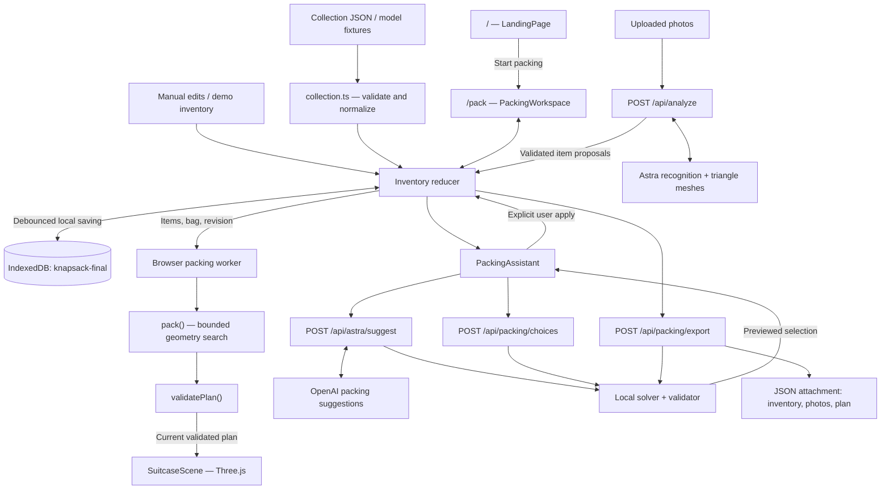

# Knapsack architecture

Source reviewed: `ab661a3`, pulled from `origin/main` on 2026-10-24. Updated for the Astra mesh increment on `bug-bash`. Review findings below are separate from changes already implemented.

## Repository and application boundaries

The repository contains three independently runnable applications. It is not currently configured as an npm workspace, and there is no shared application package.

| Location | Role | Runtime | Storage | Default development address |
| --- | --- | --- | --- | --- |
| Root `src/` | Original landing page, photo inventory, and packing prototype | Next.js, React, TypeScript, React Three Fiber | IndexedDB `knapsack-local` | `http://127.0.0.1:3000` |
| `step2/` | Standalone packing studio that introduced essentials, swaps, Astra, and model imports | React/Vite frontend, imperative Three.js, Express API | localStorage `knapsack-step2-v1` | Frontend `:5173`, API `:3001` |
| `final/` | Combined application and current development target | Next.js, React, TypeScript, React Three Fiber | IndexedDB `knapsack-final` | `http://127.0.0.1:3000` |

`final/` contains copies and adaptations of the original implementations. It does not mount the Vite studio, call its Express server, or import application code from outside its folder. The root and final applications default to the same port; start the chosen application rather than both on that port. Their separate database names preserve their existing sessions independently even when they use the same browser origin. There is no automatic migration between their saved sessions.

## Combined application map

## Routes and user interface

`final/src/app/page.tsx` and `final/src/app/pack/page.tsx` are thin route entry points. The shared layout supplies metadata and global styling. Error and not-found routes provide recovery and a path back to the workspace.

### Landing page

`components/landing/LandingPage.tsx` owns the sticky story, scroll progress, chapter text, packing counter, navigation, FAQ, and illustrative suitcase color previews. A passive scroll listener schedules updates through `requestAnimationFrame`. Progress is shared with the dynamically loaded `PackingScene.tsx` through a ref.

The landing scene builds its suitcase and eight travel items procedurally. Each item interpolates between authored start and end transforms as the user scrolls; the lid closes at the end. These transforms are authored for the marketing animation and do not call the inventory packing solver. Its artwork is independent of the traveler's saved inventory. It supports reduced motion, an illustrated WebGL fallback, and pauses rendering when it leaves the viewport.

### Packing workspace

`components/packing/PackingWorkspace.tsx` is the main client-side coordinator. It owns the reducer, restoration/autosave lifecycle, upload queue, worker, active item, editing panels, suitcase selection, collection import, export, playback, inspection settings, and assistant visibility.

`PackingAssistant.tsx` owns the Astra and make-room dialogs, request cancellation, current-revision filtering, suggestion preview, and explicit apply controls. Its styles are a CSS Module. The main workspace still uses application-wide CSS classes.

`SuitcaseScene.tsx` renders the computed plan. Astra photo items render their supplied triangle meshes through `GeneratedMesh.tsx`; the item editor uses the same geometry renderer. It also supports manual/demo category shapes, optional glTF item and bag assets, animated placement, selection, orbit/zoom, top view, reset, layer filtering, exploded inspection, and packing-order playback. Failed imported-asset loads fall back to category geometry; failed photo mesh generation produces an explicit photo error. A lost WebGL context presents a retry action. These display settings do not change which items the solver includes.

## Domain and state

`lib/domain.ts` defines the shared Zod schemas and TypeScript contracts:

- `Item`: stable ID, category, representative color/appearance, estimated dimensions, per-axis visual scale, inclusion, allowed orientation indices, source photo IDs, proposal ID, essential flag, priority, and optional model URL.
- `Suitcase`: usable interior dimensions, clearance, optional appearance/model metadata, and identity.
- `Photo`: browser-held data URL, status, request identity, acceptance flag, and optional error.
- `Plan`: input revision, ordered placements, named unplaced items, outcome, conflicts, and search diagnostics.

Actual item size is `estimate × scale`. A packing revision serializes the relevant bag and item solver inputs, including inclusion, size, orientations, essential status, and priority. The app uses this revision to reject stale worker results and to hide outdated assistant previews.

`lib/state.ts` provides one inventory reducer. Manual edits, essential pins, include/exclude decisions, duplication, deletion, source-preserving merges, photo results, imports, resets, and assistant selections flow into it. A selection applies atomically, with essentials retained. Photos are accepted only for their current request ID and pending status; accepted proposal identities and dismissed IDs prevent duplicated results and resurrection of deleted proposals. Similar items produce reviewable merge suggestions rather than automatic merges.

The app limits retained state to 80 items and 12 photos. Playback, selection, layers, and the current computed plan are transient rather than the persisted source of truth.

## Packing engine and geometry

The combined app's canonical units are millimeters, with X = width, Y = length, and Z = up. The renderer converts to Y-up world coordinates at 100 millimeters per world unit. `render-transform.ts` maps permitted solver rotations to signed Three.js quaternions and provides the shared clamshell hinge pose.

Preset bags have `clamshell: true`. Their total interior depth is split into equal main and lid cavities. A placement's `compartment` field selects its local cavity; identical coordinates in different halves represent separate physical space. Bounds, clearance, support and overlap are evaluated inside each cavity. `ClamshellCase.tsx` is shared by the landing and workspace renderers. The lid and its contents rotate together about the seam, and packing playback adds a final closing step. Tests transform placement corners into the closed pose to check they remain inside the original bag dimensions. Native imports and exports preserve the flag; custom bags without it retain their single-cavity/asset contract.

`lib/packing.ts` uses a deterministic bounded search over rectangular item envelopes. It tries four item orders and adds an essential/priority-first order when those settings matter. Candidate positions come from the clearance origin and placed-item edges. It checks allowed axis permutations, wall clearance, item separation, and support. A raised item requires at least 65% footprint support during search. The default evaluation budget is 80,000 per attempted order; partial results favor essentials and higher-priority items.

`lib/validate.ts` independently checks finite positive sizes, revisions, permitted orientations and envelopes, bounds, overlap/clearance, unique sequence positions, identities, and complete placed/unplaced accounting. It does not import the search's collision helpers. Support is a search rule; the independent validator does not currently recheck support or a physical insertion path.

Outcomes distinguish complete layouts, partial layouts, exhausted search, and directly established constraints such as an item exceeding the bag in all allowed orientations or excessive total envelope volume. Exhausted search does not prove that a layout is impossible. Cloth compression, arbitrary mesh collision, and insertion-path physics are outside the implementation.

`packing.worker.ts` runs this computation off the browser's main thread. The workspace debounces requests by 180 ms, ignores mismatched revisions, and validates a returned plan again before accepting it. The server reuses the same pure solver and validator for advice previews, swap choices, and exports.

## Server routes and AI boundaries

All combined APIs run inside the Next application; the old Express server is not a dependency.

| Route | Responsibility | Boundary |
| --- | --- | --- |
| `POST /api/analyze` | Recognize belongings in one uploaded photo | Same-origin helper, bounded multipart size, file type/signature checks, two concurrent analyses per server process, validated proposals |
| `GET /api/astra/status` | Report whether a server key exists and the configured suggestion model | Configuration availability, not a live provider-health probe |
| `POST /api/astra/suggest` | Suggest a keep/leave selection from the supplied inventory and trip preference | Zod input, exact partition of known included IDs, essentials retained, solver-checked preview |
| `POST /api/packing/choices` | Calculate explicit swap options for an unplaced wanted item | Validated inventory; essential items excluded from removal candidates; remaining previously packed items retained |
| `POST /api/packing/export` | Recompute and download the latest validated plan | Same-origin helper, validated form payload, named JSON attachment, no-store response |

`lib/vision.ts` uses Astra through the server-side OpenAI SDK and structured output. `lib/model-config.ts` supplies `OPENAI_MODEL` (default `gpt-6-astra`) to both recognition and advice. Recognition returns labels, estimated dimensions, and actual low-poly vertex/triangle/material data, not shape-construction instructions. `mesh.ts` validates finite normalized coordinates, limits, topology references and nondegenerate three-dimensional geometry. `mesh-geometry.ts` converts that supplied topology to Three.js coordinates without inferring category shapes. Meshes remain approximate reconstructions rather than measured or photorealistic scans. The old vision-specific model setting is unused in the combined app.

`lib/astra.ts` uses the same model setting. It receives item IDs and metadata plus the current fit result, then returns a proposed keep/leave selection. The server validates the IDs and essentials and computes its own geometry preview. Generated mesh arrays are stripped from worker and advice payloads; the UI, storage and exports retain them. The browser applies a suggestion only after the user chooses to apply it. The model name is a code default, not a claim about model availability for another account.

Both adapters use `OPENAI_API_KEY` only on the server and request `store: false`. Missing credentials produce explicit unavailable states; manual editing, demo packing, and swap calculations do not need a model call. Neither adapter is the source of geometric truth.

## Persistence, import, and export

`lib/persistence.ts` uses `idb` with the `knapsack-final` database. The `session` store contains versioned state metadata; the `photos` store holds image data separately. Autosave is debounced by 350 ms. Restoration validates the schema and source images. Interrupted photo analyses become retryable errors. Invalid saved data is preserved until an explicit reset; the workspace can continue with temporary edits instead of silently overwriting it.

There is no application database server, account system, or cross-device sync. Uploaded photos are sent to the vision provider through the Next server; this app does not persist them on the server. The packing export also POSTs photo data to the server and includes those photos in the downloaded JSON, along with items, the bag, and a recomputed plan.

`lib/collection.ts` accepts native inventories and the step2 handoff. Native dimensions remain millimeters/Z-up. Step2 centimeter/Y-up dimensions, offsets, clearance, and allowed rotations are converted once at this boundary. Optional item and bag model URLs are loaded by the browser; they need to be reachable from the browser, including applicable CORS support. Model geometry is centered and normalized into its declared envelope.

Bundled `public/example-models.json`, `public/example-collection.json`, `public/models/`, and `public/fixtures/` support reproducible import, model, and recognition flows. Model fixtures have a regeneration script under `final/scripts/`.

## The preserved step2 studio

The standalone studio uses `App.jsx` for session/UI state, `data.js` for contract validation and main-app conversion, `packing.js` for geometry and swaps, and `Scene.jsx` for an imperative Three.js engine. It persists via localStorage. Vite proxies `/api` to Express during development; Express can also serve its built `dist/` application.

Its solver uses six item orders and a supported free-space subdivision algorithm in centimeters/Y-up. This differs from the root/final extreme-edge search. The final app ports its user flows and contracts while retaining the root solver, worker, state, and React Three Fiber renderer. Its successful standalone browser tests do not by themselves verify the final integration.

## Verification performed during this review

After installing `final/`'s own locked dependencies with `npm ci`:

| Command in `final/` | Result |
| --- | --- |
| `npm run typecheck` | Passed |
| `npm run lint` | Passed |
| `npm test` | 41 tests passed across seven files |
| `npm run build` | Passed; both UI routes and all five API routes generated |

The initial build attempt before installing those dependencies could not resolve Next inside the package's explicit Turbopack root. Installing the package's dependencies resolved it without code changes.

Root TypeScript and ESLint now exclude the independent `final/` and `step2/` packages. This fixes the earlier cross-package diagnostics caused by interpreting final-app imports with the root `@/*` alias. Both Next.js applications pass their own type checks, lint, and production builds.

This review did not make paid provider calls or rerun browser journeys. Existing final-app evidence records one passing journey and six failures in the initial seven-test suite. A partial rerun again passed overflow/essential protection; other journeys were interrupted or unstarted. The recorded initial requirement coverage is 11%, and the partial rerun is not a complete regression pass. See `final/artifacts/validation.md` and `final/artifacts/kane-recheck-partial.json` for their actual scope.

## Architecture findings and recommended sequence

1. **Establish package ownership.** `final/` is already the documented combined target, but the repository still has three source copies and separate lockfiles. Root TypeScript and lint now stay within their package. Explicit workspaces or archiving the originals could further clarify ownership. Keep existing sessions and import compatibility during any consolidation.
2. **Split workspace orchestration.** The 1,520-line `PackingWorkspace.tsx` owns UI, worker lifecycle, uploads, saving, imports, exports, and editing. Extract focused hooks for inventory persistence, photo analysis, and packing computation, then separate inventory/editor/scene panels. Preserve the single reducer and pure solver contracts.
3. **Separate advice freshness from geometry freshness.** `revisionOf()` includes solver inputs but omits labels/categories that Astra also consumes. Renaming an item leaves a prior advice revision current even though its semantic input changed. Use a distinct advice revision or inventory generation token while retaining the narrower geometry revision.
4. **Make collection formats explicit.** The current importer treats a supplied `bag` with any units other than `mm` as step2 centimeters. Use a discriminated, versioned contract so unknown units/axes are rejected rather than interpreted as a supported format.
5. **Bound server computation before a multi-user deployment.** Swap search can run a baseline solve, ten single-removal solves, and 45 pair-removal solves synchronously in a request. The photo concurrency counter is per process, and suggestions/exports have no shared job scheduling. Keep these limits explicit and move expensive search into bounded workers/jobs if concurrent use is introduced.

The package ownership, workspace orchestration, advice freshness, and deployment findings remain recommendations. The later Astra mesh and clamshell increments described above do not implement that broader package migration or UI refactor.
